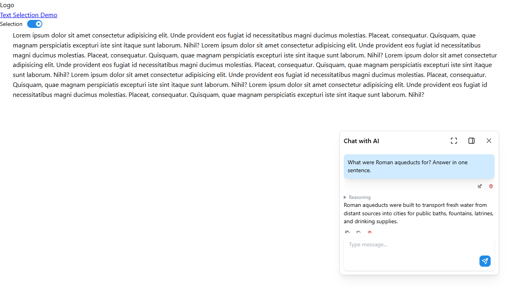
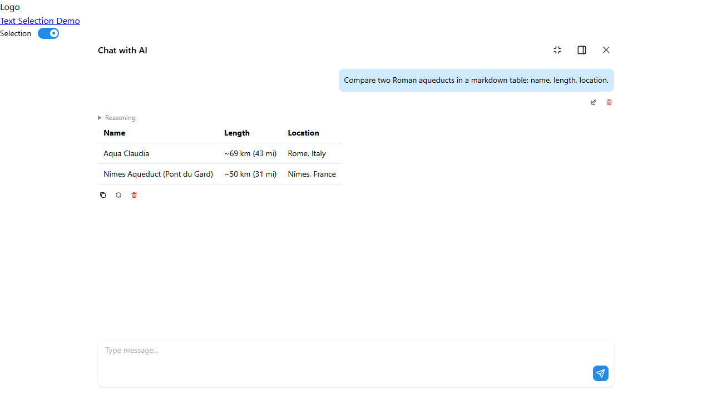
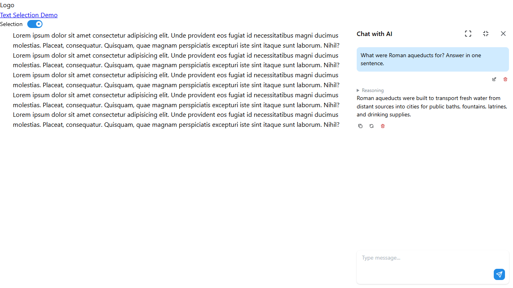
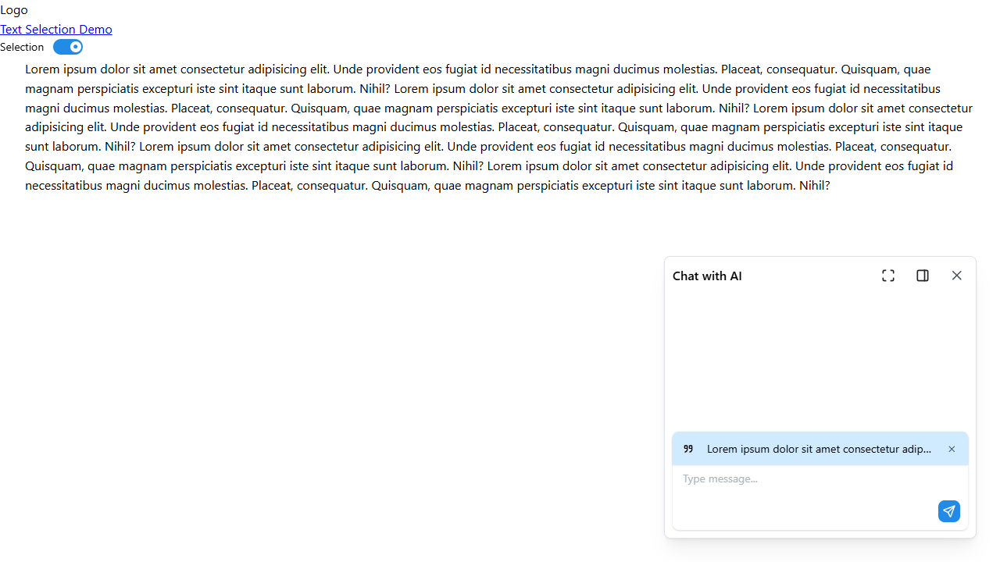

# mantine-chat-ui

Chat components for [Mantine](https://mantine.dev): a streaming chat panel with markdown answers,
collapsed reasoning, message editing, delete/restore and regenerate.



The package is UI only. It owns the transcript and the streaming flags, and asks you for one thing: a
transport that runs a turn. AG-UI servers work out of the box.

## Install

```bash
npm install mantine-chat-ui @mantine/core @mantine/hooks
```

React 19 and Mantine 9 are peer dependencies. There is no stylesheet to import: the components are
built from Mantine primitives, so your app's `MantineProvider` and `@mantine/core/styles.css` already
style them.

## Quick start

```tsx
import { MantineProvider } from "@mantine/core";
import "@mantine/core/styles.css";
import { ChatProvider, ChatWidget } from "mantine-chat-ui";

export default function App() {
  return (
    <MantineProvider>
      <ChatProvider endpoint="/agent">
        <YourApp />
        <ChatWidget />
      </ChatProvider>
    </MantineProvider>
  );
}
```

That gives you a launcher button and a floating dialog. Nothing else in your layout is touched.

## Layouts

`ChatPanel` is the bare panel. It fills its container, and the header shows only the buttons whose
callbacks you pass, so a panel in a fixed sidebar needs none.

```tsx
<ChatPanel
  title="Ask about this report"
  viewMode="aside"          // "dialog" | "expanded" | "aside" | "affix"
  onExpand={() => setView("expanded")}
  onMinimize={() => setView("dialog")}
  onClose={close}
/>
```

The same conversation in three other places. The demo app switches between them and the history
survives every move.

Expanded into the main area, with markdown tables rendered through Mantine:



Docked in a sidebar while the page content reflows:



Text selected on the page, offered to the chat as context:



The panel is a normal React component, so where it lives is your decision: a `Dialog`, an
`AppShell.Aside`, a column in a split view, or the whole page. The demo app in `src/demo` shows all
four placements sharing one conversation.

## Talking to something that is not AG-UI

`endpoint` covers AG-UI servers. For anything else, pass a transport:

```tsx
const transport = {
  async run({ history, abortController, onMessages }) {
    const res = await fetch("/my-api/chat", {
      method: "POST",
      body: JSON.stringify({ messages: history }),
      signal: abortController.signal,
    });
    // Stream however you like, calling onMessages with the full transcript each time.
    onMessages([...history, { id: crypto.randomUUID(), role: "assistant", content: await res.text() }]);
  },
};

<ChatProvider transport={transport}>...</ChatProvider>;
```

Give it a stable identity (a module constant or `useMemo`): the provider reads it once on mount.
`createAgUiTransport({ url, threadId })` is the default implementation, exported if you want to wrap
it.

## Selection to question

The panel accepts `referencedText`, whatever produced it. Show a button near the selection on your
side, then hand the text over: it appears as a quoted chip above the input and is sent as context
with the next question.

```tsx
<ChatPanel referencedText={selectedText} onResetReferencedText={() => setSelectedText(null)} />
```

The demo app's `src/demo/useSelectionEndpoint.ts` shows one way to find `{ x, y }` for the current
selection. It is sample code, not part of the package.

## One conversation per provider

`ChatProvider` creates the store, so two providers on a page are two independent conversations and
unmounting one drops its transcript. Because the transcript lives above the panel, moving the panel
between layouts, or unmounting it entirely mid-answer, does not lose anything: the stream keeps
filling the store and the panel renders it when it comes back.

Pass `initialMessages` to seed history and `threadId` to keep a server-side thread stable. For custom
state access:

```tsx
const { messages, setMessages } = useChatMessages();
const { isStreaming } = useChatStreaming();
const stop = useStopStreaming();
```

## Development

```bash
npm install
npm run dev          # demo app on the source, proxied to localhost:5059
npm run build:lib    # dist/index.js and dist/index.d.ts
npm run build:demo   # demo-dist
npm run lint
```

`src/lib` is the package. `src/demo` is the sample app and is not published.

## License

MIT
