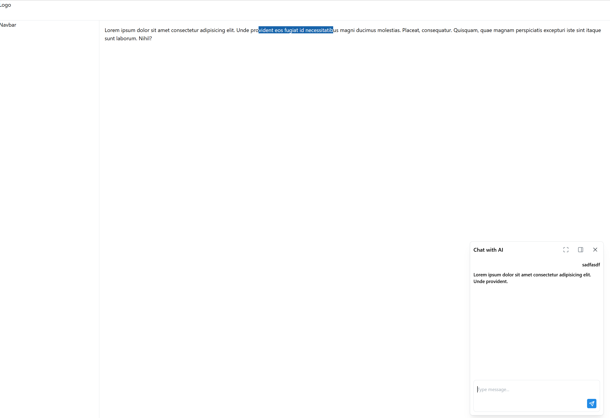
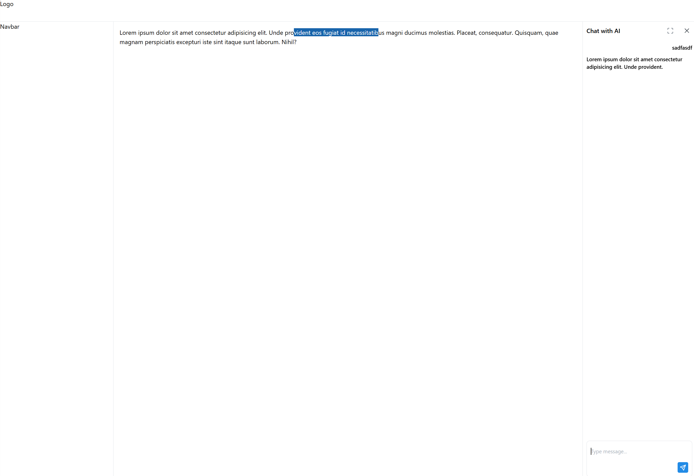
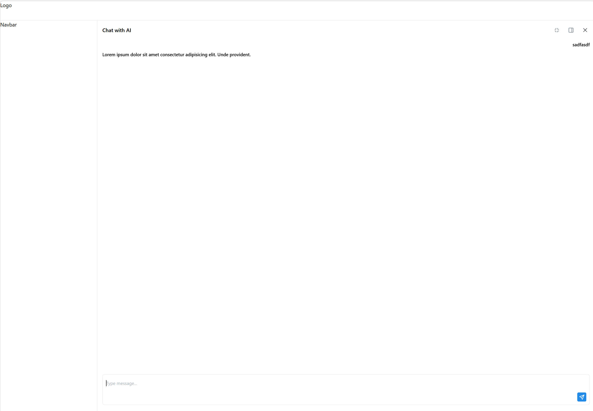

# mantine-chat-ui

Chat UI components for [Mantine](https://mantine.dev). A streaming AG-UI chat panel with markdown
answers, collapsed reasoning, message editing, delete/restore and regenerate, plus a text-selection
"explain this" hook.

The package is UI only: it owns the transcript and the streaming flags, and asks you for one thing,
a transport that runs a turn.

## Install

```bash
npm install mantine-chat-ui @mantine/core @mantine/hooks
```

React 19 and Mantine 9 are peer dependencies. There is no stylesheet to import: the components are
built from Mantine primitives, so whatever `MantineProvider` and `@mantine/core/styles.css` your app
already has applies.

## Use

Whole widget, launcher and dialog included:

```tsx
import { MantineProvider } from "@mantine/core";
import "@mantine/core/styles.css";
import { ChatProvider, ChatWidget } from "mantine-chat-ui";

export default function App() {
  return (
    <MantineProvider>
      <ChatProvider endpoint="/agent">
        <YourApp />
        <ChatWidget />
      </ChatProvider>
    </MantineProvider>
  );
}
```

Docked panel instead, for a sidebar or a split view:

```tsx
import { ChatPanel } from "mantine-chat-ui";

<ChatPanel
  title="Ask about this report"
  viewMode="aside"
  onExpand={() => setView("expanded")}
  onMinimize={() => setView("dialog")}
  onClose={close}
  referencedText={selectedText}
  onResetReferencedText={() => setSelectedText(null)}
/>;
```

`viewMode` is `"dialog" | "expanded" | "aside" | "affix"`; the header only shows the buttons whose
callbacks you pass, so a panel in a fixed sidebar needs no callbacks at all.

### Talking to something that is not AG-UI

`endpoint` covers AG-UI servers. For anything else, pass a transport:

```tsx
const transport = {
  async run({ history, abortController, onMessages }) {
    const res = await fetch("/my-api/chat", {
      method: "POST",
      body: JSON.stringify({ messages: history }),
      signal: abortController.signal,
    });
    // Stream whatever you like, calling onMessages with the full transcript each time.
    onMessages([...history, { id: crypto.randomUUID(), role: "assistant", content: await res.text() }]);
  },
};

<ChatProvider transport={transport}>...</ChatProvider>;
```

Build a stable transport (module constant or `useMemo`): the provider reads it once on mount.

`createAgUiTransport({ url, threadId })` is the default implementation, exported if you want to
wrap it, and `useSelectionEndpoint` is exported for building your own select-to-ask affordance.

## Selection to question

`useSelectionEndpoint({ containerRef, ignoreSelector, enabled })` returns `{ x, y }` for the current
selection, or `null`. Position an `ActionIcon` there, and pass the selected text to `ChatPanel` as
`referencedText`: it shows up as a quoted chip above the input and is sent as context with the next
question.

## One conversation per provider

`<ChatProvider>` creates the store, so two providers on a page are two independent conversations, and
unmounting one drops its transcript. Pass `initialMessages` to seed history and `threadId` to keep a
server-side thread stable. For custom state access:

```tsx
const { messages, setMessages } = useChatMessages();
const { isStreaming } = useChatStreaming();
const stop = useStopStreaming();
```

## Development

```bash
npm install
npm run dev          # demo app on the source, proxied to localhost:5059
npm run build:lib    # dist/index.js + d.ts
npm run build:demo   # demo-dist, the GitHub Pages build
npm run lint
```

`src/lib` is the package. `src/demo` is the sample app, not published.




